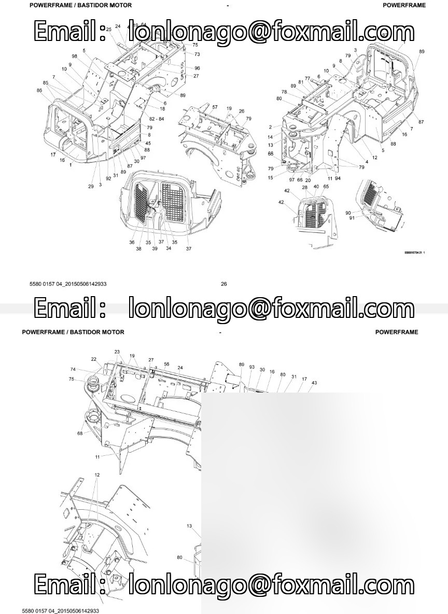

# Atlas Copco Scooptram ST2G excavator parts manual

## Body

Atlas Copco Scooptram ST2G shovel and conveyor original factory parts book, 580 pages.
including detailed structural diagrams of the power assembly, vehicle frame, hydraulic system and other systems, suitable for repair, study and parts inquiry.
392-899

The catalogue covers Atlas Copco Scooptram ST2G shoveler original spare parts, including detailed structural drawings for power frames, chassis and hydraulic systems, plus numbered and version information.

<!-- AI_ENRICHED -->

## Images

## Payment

Here is a pay link on Stripe ( https://buy.stripe.com/3cs8yP7sY87d0vu9AB ). Please contact me lonlonago@foxmail.com after funding $89, and I will send you a complete data files , thank you!

